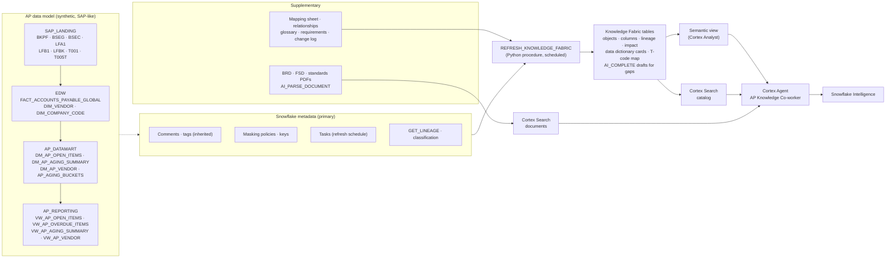

# AP Knowledge Co-worker on Snowflake

An **AI-powered data dictionary** for an SAP-style Accounts Payable (AP) data model, built entirely in Snowflake.
Data engineers ask in plain English and a **Cortex Agent** answers from Snowflake's own metadata:

- Which tables and views make up the AP model, and how are they connected?
- Where does a report field (e.g. vendor country) come from, back to the SAP source?
- How is AP aging defined, and which buckets exist?
- How often is the datamart refreshed, and which fields are masked?
- What breaks if a source field changes? Which reports depend on it?
- A request mentions an SAP T-code: do we already have that data, or do we need new replication?

> **Everything is synthetic**: generated SAP-like data, generated project documents, generic names. It is a learning project and reference implementation, not production code.

## Architecture



## The problem it solves

In a typical SAP → EDW → datamart → BI landscape, a new request ("rebuild this report", "give us the KPIs from this T-code") starts with days of digging: does the data already exist, where does each field come from, which rules apply, is it masked, who owns it, is the SAP field even replicated? The knowledge is spread over table comments, mapping sheets, specs and a few experts. This project puts it in one place and lets an agent answer, with sources.

## What gets built

| Layer | Objects |
|---|---|
| `SAP_LANDING` | SAP-like tables `SAP_BKPF`, `SAP_BSEG`, `SAP_BSEC`, `SAP_LFA1`, `SAP_LFB1`, `SAP_LFBK`, `SAP_T001`, `SAP_T005T` (300 vendors, 6,000 invoices) |
| `EDW` | `FACT_ACCOUNTS_PAYABLE_GLOBAL` (vendor lines), `DIM_VENDOR`, `DIM_COMPANY_CODE`, load procedures and a daily task chain |
| `AP_DATAMART` | `DM_AP_OPEN_ITEMS` (aging), `DM_AP_AGING_SUMMARY`, `DM_AP_VENDOR`, `AP_AGING_BUCKETS` |
| `AP_REPORTING` | `VW_AP_OPEN_ITEMS`, `VW_AP_OVERDUE_ITEMS`, `VW_AP_AGING_SUMMARY`, `VW_AP_VENDOR` (rename / key filter only) |
| `GOVERNANCE` | 12 tags with inheritance (domain, layer, owner, technical owner, refresh, data class, sensitivity, key role ...), 4 masking policies incl. a conditional one, primary / business keys, optional classification |
| `KNOWLEDGE_FABRIC` | Metadata catalog built from live Snowflake metadata, lineage and impact, data dictionary card per reporting view, glossary + KPIs, requirements trace, mapping change log, SAP T-code map, 4 parsed documents, 2 Cortex Search services, a semantic view, the agent and an evaluation set |

## Snowflake features used

Cortex Agents and Snowflake Intelligence · Cortex Search · Cortex Analyst with a semantic view (verified queries) · `AI_COMPLETE` (drafts descriptions for undocumented columns, for a steward to approve) · `AI_PARSE_DOCUMENT` + `SPLIT_TEXT_RECURSIVE_CHARACTER` · tags and tag inheritance · masking policies · `INFORMATION_SCHEMA` (`TAG_REFERENCES`, `POLICY_REFERENCES`) · `SHOW PRIMARY KEYS` · tasks · `SNOWFLAKE.CORE.GET_LINEAGE` · `SYSTEM$CLASSIFY`.

## How to run (about 15 minutes)

Requirements: **Enterprise edition**, a role that can create a database, warehouse and roles (default `ACCOUNTADMIN`), and Cortex AI available (`SELECT AI_COMPLETE('claude-sonnet-4-5', 'hello');` must work).

1. Check `config.py` (every name lives there).
2. Snowsight → **Workspaces → + Add new → Upload folder** → upload this folder.
3. Create a Python notebook **next to `run.py`** and run:
   ```python
   import run
   run.run()      # builds sql/00 to sql/13
   run.check()    # counts per component
   ```
4. Open **AI → Snowflake Intelligence → AP Knowledge Co-worker** (or add it from **AI → Agents**).

Helpers: `run.demo_masking()`, `run.lineage_preview("VENDOR_COUNTRY")`, `run.impact_preview("LAND1", "SAP_LFA1")`, `run.view_card("VW_AP_OPEN_ITEMS")`, `run.refresh()`.

Expected `run.check()`: 19 objects, 14 masked columns (10 direct + 4 inherited by views), 6 undocumented columns with AI drafts, 4 reporting view cards, 22 T-code mappings, parsed document chunks.

## Questions to try

1. Which tables and views make up the AP model, and how are they connected?
2. Where does vendor country in the AP open items report come from, back to the source?
3. How is AP aging defined, and which aging buckets exist?
4. How often is the AP datamart refreshed, and which fields are masked?
5. Show the data dictionary card for VW_AP_OPEN_ITEMS
6. A request asks for the data in T-code FBL1N. Do we already have it in EDW?
7. What is affected if the vendor master country field changes?
8. What changed in the vendor country mapping, and why?

## Files

| Path | What it is |
|---|---|
| `config.py` | All names, roles, model, data volume, schedule |
| `run.py` | Fills `{{NAMES}}` from config, runs the SQL files in order, uploads the documents, helper functions |
| `sql/00` - `sql/13` | The build, one step per file (each file starts with a header explaining it) |
| `sql/optional/metadata_inventory.sql` | Inventory of the governance metadata that already exists in a real account (ACCOUNT_USAGE) |
| `docs/` | Synthetic BRD, functional spec, governance standard, process and EDW standards |
| `tools/make_documents.py` | Regenerates the synthetic documents |

## Design choices

- **Snowflake metadata first.** Comments, tags (with inheritance), masking policies, keys and task schedules are read live by one procedure; documents, the mapping sheet and the glossary are supplementary.
- **Comment convention** `Business name: description` gives every column a business name without a separate table.
- **Views inherit masking**, and the catalog shows it as *masked via* the upstream column.
- **Deliberate gaps** (6 columns, 1 table without a description) show gap detection and AI drafts awaiting steward approval.
- **Glossary terms have owner, status (Approved / Draft) and source**, ready to move into a business ontology later.
- **Evaluation set** of 26 questions with expected answers for Snowsight agent evaluations.
